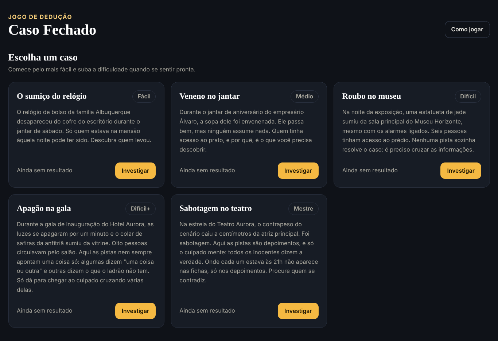
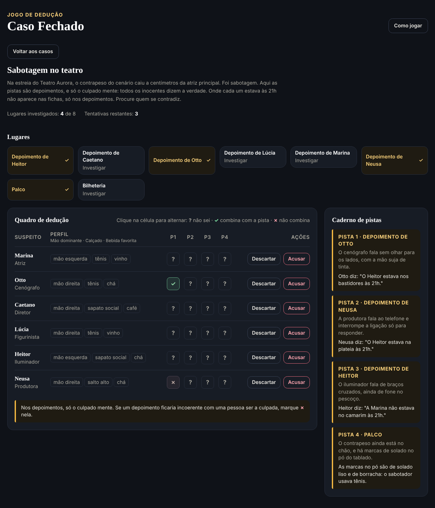

# Caso Fechado

Jogo de detetive que roda no navegador. Você investiga lugares, lê as pistas e cruza tudo com o perfil dos suspeitos até descobrir quem é o culpado.

Fiz este projeto para praticar React e TypeScript num caso com regra de verdade por trás, e não só tela. A parte mais divertida de escrever foi o motor de dedução, que também serve para conferir se cada caso tem uma única solução.





## Como se joga

Cada caso tem uma lista de suspeitos e uma lista de lugares, e cada lugar guarda uma pista. Quando você investiga um lugar, a pista vai para o caderno e ganha uma coluna no quadro de dedução. Dali em diante é com você: compare a pista com o perfil de cada suspeito e marque ✓, ✗ ou ? em cada célula. O jogo não corrige suas marcas.

Quando tiver certeza, acuse. Você tem 3 tentativas, e cada erro mostra qual pista já derrubava aquela acusação. No fim, o caso rende de 1 a 3 estrelas: cada acusação errada tira uma, e investigar mais lugares do que o necessário tira outra. O melhor resultado de cada caso fica salvo no navegador.

Na primeira visita abre um tutorial curto. Dá para rever pelo botão "Como jogar".

## Os casos

| Caso | Nível | O que muda |
| --- | --- | --- |
| O sumiço do relógio | Fácil | Pistas diretas, 5 suspeitos |
| Veneno no jantar | Médio | Pistas que dizem o que o culpado não tem |
| Roubo no museu | Difícil | Nenhuma pista resolve sozinha |
| Apagão na gala | Difícil+ | 8 suspeitos, 6 traços e pistas do tipo "tênis ou bota" |
| Sabotagem no teatro | Mestre | Só há depoimentos, e só o culpado mente |

No caso mestre, o lugar onde cada um estava não aparece nas fichas. O jeito de resolver é achar dois depoimentos que se contradizem, porque um dos dois está mentindo, e depois usar uma pista física para decidir entre eles.

## Como a lógica funciona

Cada pista diz que o culpado tem, ou não tem, um ou mais valores de um traço (mão dominante, calçado, bebida e assim por diante). Um suspeito só pode ser o culpado se for coerente com todas as pistas descobertas.

Os depoimentos são o caso mais interessante. Como o local de cada um é desconhecido, o motor trata esses valores como incógnitas e testa, para cada suspeito, se existe uma versão dos fatos em que todos os outros falam a verdade e só ele mente. O código está em `src/domain/deduction.ts`.

Essa mesma regra é usada em três lugares:

- no jogo, para dizer qual pista contradiz uma acusação errada;
- na validação dos casos, que recusa caso ambíguo, culpado contradito pelas pistas e depoimento que quebra a regra de que só o culpado mente;
- no cálculo do mínimo de pistas necessárias, que testa combinações até achar a menor que isola o culpado. É esse número que define se o jogador investigou demais.

Por isso dá para escrever caso novo sem medo. Se ele tiver mais de um culpado possível, os testes quebram e apontam o problema.

## Tecnologias

HTML, CSS3, JavaScript e TypeScript (modo estrito), React 19, Tailwind CSS 4, Vite, Vitest e Testing Library. Versionamento com Git e GitHub.

## Como rodar

```bash
npm install
npm run dev
```

O Vite mostra o endereço no terminal, normalmente http://localhost:5173.

Outros comandos:

| Comando | O que faz |
| --- | --- |
| `npm test` | Roda os testes |
| `npm run build` | Confere os tipos e gera a versão de produção em `dist/` |
| `npm run preview` | Serve a versão de produção localmente |

## Estrutura

```
src/
  domain/          regras puras: casos, pistas, dedução, investigação, pontuação
  application/     portas de armazenamento (progresso e tutorial)
  infrastructure/  implementações com localStorage
  data/cases/      os cinco casos do jogo
  presentation/    telas em React, hooks e textos
  testing/         dublês e configuração dos testes
  compositionRoot.ts  liga as implementações às portas
```

O domínio não sabe que React ou o navegador existem. A investigação é uma sequência de funções puras que recebem o estado e devolvem o novo estado, ou o motivo da recusa. Os componentes só chamam essas funções e mostram o resultado.

## Criando um caso novo

1. Crie um arquivo em `src/data/cases/` seguindo o formato de `mansionWatch.ts`.
2. Adicione o caso na lista de `src/data/cases/index.ts`.
3. Rode `npm test`. A validação avisa se faltar algum traço, se uma pista citar valor que ninguém tem, se um depoimento não seguir a regra ou se houver mais de um culpado possível.
