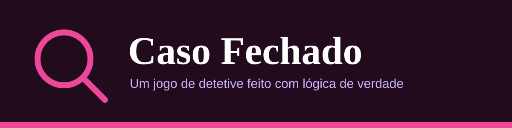
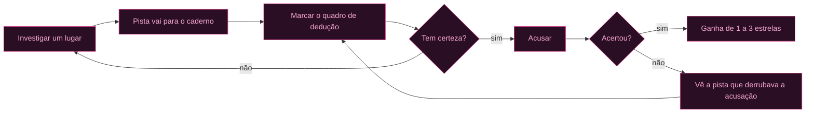
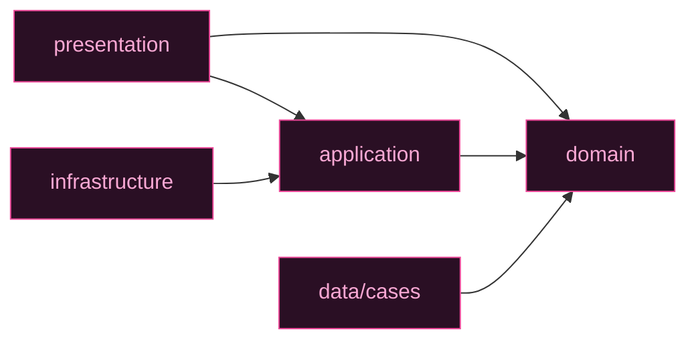

<div align="center">



<br>


</div>

Jogo de detetive que roda no navegador. Você investiga lugares, lê as pistas e cruza tudo com o perfil dos suspeitos até descobrir quem é o culpado.

Fiz este projeto para praticar React e TypeScript num caso com regra de verdade por trás, e não só tela. A parte mais divertida de escrever foi o motor de dedução, que também serve para conferir se cada caso tem uma única solução.

| Escolha dos casos | Tela de investigação |
| :---: | :---: |
|  |  |

## Índice

- [Destaques](#destaques)
- [Como se joga](#como-se-joga)
- [Os casos](#os-casos)
- [Como a lógica funciona](#como-a-lógica-funciona)
- [Tecnologias](#tecnologias)
- [Como rodar](#como-rodar)
- [Testes](#testes)
- [Estrutura](#estrutura)
- [Criando um caso novo](#criando-um-caso-novo)

---

## Destaques

| | |
| --- | --- |
| **5 casos** | De um roubo simples a um caso só de depoimentos, com 5 níveis de dificuldade |
| **Motor de dedução** | Resolve pistas, depoimentos e incógnitas, e prova que cada caso tem um único culpado |
| **Quadro manual** | O jogo não corrige suas marcas: quem raciocina é você |
| **Domínio puro** | As regras não dependem de React nem do navegador |
| **Progresso salvo** | Seu melhor resultado de cada caso fica guardado no navegador |

---

## Como se joga

Cada caso tem uma lista de suspeitos e uma lista de lugares, e cada lugar guarda uma pista. O caminho de uma partida é este:



1. **Investigue um lugar.** A pista vai para o caderno e ganha uma coluna no quadro de dedução.
2. **Compare a pista com cada suspeito** e marque a célula correspondente.
3. **Descarte quem já não serve** para não perder de vista quem sobrou.
4. **Acuse quando tiver certeza.** Você tem 3 tentativas.

> [!NOTE]
> O jogo não corrige suas marcas. Elas servem só como anotação sua, e é justamente isso que faz o caso exigir raciocínio.

### O quadro de dedução

Cada célula cruza um suspeito com uma pista e vai passando por três marcações:

| Marca | Significa |
| :---: | --- |
| ✓ | O perfil do suspeito combina com a pista |
| ✗ | O perfil não combina, então ele provavelmente é inocente |
| ? | Ainda não decidi |

Um quadro no meio de um caso fica mais ou menos assim:

| Suspeito | Pista 1: bebe chá | Pista 2: usa bota |
| --- | :---: | :---: |
| Otto | ✓ | ✓ |
| Neusa | ✗ | ? |
| Heitor | ✓ | ✗ |

Aqui só o Otto passou nas duas pistas, mas ainda faltam lugares para investigar antes de acusar.

### Pontuação

Quando você erra, o jogo mostra qual pista já derrubava aquela acusação. No fim, o caso rende de 1 a 3 estrelas.

| Resultado | Estrelas |
| --- | :---: |
| Acertou sem errar e sem investigar lugares demais | ★★★ |
| Um erro, ou lugares a mais do que o necessário | ★★☆ |
| Dois erros, ou um erro mais lugares a mais | ★☆☆ |

> [!TIP]
> Cada acusação errada tira uma estrela, e investigar mais lugares do que o necessário tira outra. O mínimo é sempre 1 estrela.

Na primeira visita abre um tutorial curto. Dá para rever pelo botão "Como jogar".

---

## Os casos

| Caso | Nível | O que muda |
| --- | :---: | --- |
| O sumiço do relógio |  | Pistas diretas, 5 suspeitos |
| Veneno no jantar |  | Pistas que dizem o que o culpado não tem |
| Roubo no museu |  | Nenhuma pista resolve sozinha |
| Apagão na gala |  | 8 suspeitos, 6 traços e pistas do tipo "tênis ou bota" |
| Sabotagem no teatro |  | Só há depoimentos, e só o culpado mente |

> [!IMPORTANT]
> No caso mestre, o lugar onde cada um estava não aparece nas fichas. O jeito de resolver é achar dois depoimentos que se contradizem, porque um dos dois está mentindo, e depois usar uma pista física para decidir entre eles.

---

## Como a lógica funciona

Cada pista diz que o culpado tem, ou não tem, um ou mais valores de um traço (mão dominante, calçado, bebida e assim por diante). Um suspeito só pode ser o culpado se for coerente com todas as pistas descobertas.

<details>
<summary>Como os depoimentos entram na conta</summary>

<br>

Os depoimentos são o caso mais interessante. Como o local de cada um é desconhecido, o motor trata esses valores como incógnitas e testa, para cada suspeito, se existe uma versão dos fatos em que todos os outros falam a verdade e só ele mente. O código está em `src/domain/deduction.ts`.

</details>

<details>
<summary>Onde a mesma regra é reaproveitada</summary>

<br>

- no jogo, para dizer qual pista contradiz uma acusação errada;
- na validação dos casos, que recusa caso ambíguo, culpado contradito pelas pistas e depoimento que quebra a regra de que só o culpado mente;
- no cálculo do mínimo de pistas necessárias, que testa combinações até achar a menor que isola o culpado. É esse número que define se o jogador investigou demais.

</details>

> [!TIP]
> Por isso dá para escrever caso novo sem medo. Se ele tiver mais de um culpado possível, os testes quebram e apontam o problema.

---

## Tecnologias

| Área | O que usei |
| --- | --- |
| Interface | HTML, CSS3, React 19 e Tailwind CSS 4 |
| Linguagem | JavaScript e TypeScript em modo estrito |
| Build | Vite |
| Testes | Vitest e Testing Library |
| Versionamento | Git e GitHub |

---

## Como rodar

Você precisa de uma versão recente do Node.js e do npm.

```bash
npm install
npm run dev
```

O Vite mostra o endereço no terminal, normalmente http://localhost:5173.

Outros comandos:

| Comando | O que faz |
| --- | --- |
| `npm test` | Roda os testes |
| `npm run build` | Confere os tipos e gera a versão de produção em `dist/` |
| `npm run preview` | Serve a versão de produção localmente |

---

## Testes

Os testes cobrem as regras do jogo e as telas principais:

- **Dedução:** pistas, depoimentos e o cálculo de quem ainda pode ser o culpado.
- **Validação dos casos:** cada um dos cinco casos precisa ter um único culpado possível.
- **Investigação e pontuação:** inspeção de lugares, descarte, marcações, acusações e estrelas.
- **Armazenamento:** progresso e tutorial, inclusive com JSON inválido e navegador com o armazenamento bloqueado.
- **Telas:** tutorial, escolha de caso, quadro de dedução e fim do caso.

```bash
npm test
```

---

## Estrutura

```
src/
  domain/             regras puras: casos, pistas, dedução, investigação, pontuação
  application/        portas de armazenamento (progresso e tutorial)
  infrastructure/     implementações com localStorage
  data/cases/         os cinco casos do jogo
  presentation/       telas em React, hooks e textos
  testing/            dublês e configuração dos testes
  compositionRoot.ts  liga as implementações às portas
```

As camadas se enxergam assim:



<details>
<summary>Decisões de projeto</summary>

<br>

O domínio não sabe que React ou o navegador existem. A investigação é uma sequência de funções puras que recebem o estado e devolvem o novo estado, ou o motivo da recusa. Os componentes só chamam essas funções e mostram o resultado.

O armazenamento fica atrás de portas na camada de aplicação, então trocar o `localStorage` por outra coisa não mexe nas regras nem nas telas.

</details>

---

## Criando um caso novo

1. Crie um arquivo em `src/data/cases/` seguindo o formato de `mansionWatch.ts`.
2. Adicione o caso na lista de `src/data/cases/index.ts`.
3. Rode `npm test`.

> [!WARNING]
> A validação avisa se faltar algum traço, se uma pista citar valor que ninguém tem, se um depoimento não seguir a regra ou se houver mais de um culpado possível. Se algum teste quebrar, o caso ainda não está pronto.
